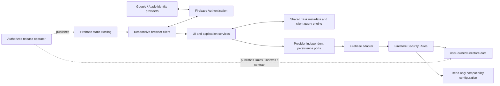

# Taskify architecture, stack and deployment strategy

22 October 2026. High-level design; implementation details belong to vertical slices.

## Authority and status

[Project status](project_status.md), [product specification §§17–23](product_spec.md)
and [accepted feasibility decisions](feasibility/firebase-validation-decisions.md)
control this document. **Accepted baseline** below consolidates those decisions.
Items explicitly marked **proposed** are design recommendations for review, not
new approved product requirements or claims of implementation.

The Foundation skeleton/proof is implemented and locally validated; see its
[validation](slices/01-foundation-validation.md). Product features and cloud
deployment remain unimplemented. Overall Firebase
Spark feasibility remains **INCONCLUSIVE**. The isolated compatibility candidate
passed 247/247 local tests; that result does not establish browser integration,
live identity-provider behavior, production indexes or actual billed usage.
Frozen experiment files and the immutable legacy specification are unchanged.

## Architecture and technology stack

| Layer | Accepted baseline | Slice-level detail / open choice |
|---|---|---|
| Presentation | One responsive browser client for mobile and desktop layouts, following §§19–21 | React, React Router and CSS Modules/tokens selected in Foundation; product component/accessibility details remain slice work |
| Application/domain | Client services orchestrate lifecycle operations, validation, navigation and provisioning | Command contracts, module boundaries and dependency composition |
| Shared state | Shared normalized lightweight Task metadata; reactive filtering, grouping, sorting, Search and Dashboard calculations over the complete eligible population | Zustand vanilla factory selected; product loading/reconciliation/cache contracts remain slice work |
| Persistence boundary | Provider-independent application ports with an initial Firebase adapter | Port signatures and error/result contracts; Rules remain provider-specific |
| Identity | Firebase Authentication; Google and Apple sign-in intent under §21.5; persistent device authentication | Provider feasibility and secure linking remain unverified; email OTP is only a candidate |
| Data | Browser-direct Cloud Firestore, cloud-authoritative acknowledgements, no offline write synchronization | Production collections, indexes, write transport and reconnect handling |
| Security | Firestore Rules enforce ownership, lifecycle, version integrity, required immutable events and deletion consistency | Complete schema and adversarial coverage; no further constraint relaxation approved |
| Hosting | Firebase static Hosting on Spark | Project/region/domain choices, cache headers and release process |
| Attachments | External links only; no binary storage or upload dependency | Independent Task-link ownership and schema, in addition to Discussion links |
| Development verification | TypeScript application baseline; local Node/Java/Firebase emulators and pinned experiment dependencies | Application build/test tools and production dependency versions remain to be selected |

**Owner-agreed stack baseline, 22 October 2026:** TypeScript for UI,
application/domain services and persistence adapters; static responsive browser
delivery. Provider-specific SDK calls stay inside adapters, and UI uses application
services. Foundation selected React/Vite, React Router data mode, Zustand vanilla stores,
CSS Modules/tokens and Vitest/Testing Library/Playwright. Exact pins and accepted
local-tooling advisory conditions are in the [dependency review](slices/01-foundation-dependencies.md).
The application toolchain is separate from frozen experiment dependencies. The experiment's Node 22.16.0,
Java 21.0.12.1, Firebase SDK 11.10.0, CLI 14.27.0 and emulator 1.19.8 identify
reproduction tools, not an approved current production dependency set. Java and
Node are local build/test tools, not separately hosted application services.

### Reusable business layer — owner-agreed boundaries

Owner agreement, 22 October 2026: separate business code from UI and data-provider
code so it can be reused in a possible future server business tier.

| Layer | Responsibility | Possible future reuse |
|---|---|---|
| Domain | Lifecycle rules, validation, date semantics and query meaning | Reuse independently of runtime |
| Application services | Coordinate business commands and required atomic effects | Reuse where independent of browser/UI lifecycle |
| Persistence ports | Domain-oriented loading and atomic operation contracts | Reuse contracts; implement environment-specific adapters |
| Firebase browser adapter | SDK calls, transactions and provider serialization | Replace/supplement with a server adapter if separately approved |
| UI / reactive store | Forms, navigation, presentation and browser state | Remain client-side |

Dependencies point from UI to application services to ports/adapters; domain
rules do not import UI or Firebase libraries. Use plain domain types rather than
browser APIs, framework state or Firebase document types. Supply identity, clocks,
IDs and persistence through explicit interfaces. Define atomic boundaries around
whole business operations, not generic CRUD calls that separate mandatory effects.
Validate external data at runtime; TypeScript types alone do not do so.

Today, application/domain code runs in the browser behind a Rules-enforced data
boundary. A future server endpoint could invoke the same business code through a
server persistence adapter, with the UI using an API adapter. Reuse is practical,
not a promise of zero-change migration. Server authentication/authorization,
transaction behavior and direct browser-write policy would need explicit design.
Rules cannot be replaced merely by moving shared code; a privileged server adapter
must independently enforce the required security and integrity guarantees.

No server runtime, hosted API, endpoint implementation or infrastructure migration
is authorized by these boundaries. Exact modules/ports belong to slices; there is
no need to create a speculative server package now.

### Identity and account linking — owner-agreed policy

Owner agreement, 22 October 2026:

- Ownership uses a stable authenticated account ID, not an email address.
- Google and Apple remain intended providers, subject to feasibility validation.
- Linking requires authenticated proof of control of both identities. A matching
  verified email is an account-resolution hint, not sufficient authorization to
  merge accounts or access the existing account's data.
- Different/private email addresses do not imply different people or authorize
  automatic linking. Offer explicit linking from an authenticated account.
- Do not automatically merge Tasks/data from existing duplicate accounts. Any
  such recovery requires a separately defined process.
- Workspace provisioning is idempotent and retryable; interrupted initialization
  must not duplicate defaults.

Provider configuration, linking screens, proof/re-authentication mechanics and
recovery remain slice details. This policy refines §21.5's same-account intent
without claiming automatic provider linking or verified platform feasibility.

No custom API, Cloud Functions, server-managed Taskify sessions, paid runtime,
Blaze upgrade or binary object storage is part of the accepted runtime topology.

## Runtime and deployment topology

The browser and its embedded release metadata are untrusted. Auth establishes
identity; Rules authorize data access. Compatibility gating protects supported
clients from using incompatible releases; it does not authenticate client code.
The privileged operator is a manual release/recovery role, not a hosted backend.
Administrative credentials must stay outside browser bundles.

**Environment direction:** retain local loopback emulators with `demo-` project
IDs. Owner-designated PoC/testing project `taskify-dev-dpdhole` (number
`243252492098`) is independently verified, active and has no linked billing
account. The owner explicitly requested a clean start: legacy Firestore database,
Rules, custom-domain binding and browser API key were removed; see
[reset evidence](slices/firebase-clean-start.md). The empty default Hosting container
remains because Firebase prohibits deleting it. New Auth/Firestore resources and
configuration belong to their scoped slices; no legacy data migration is intended.
The [Hosting checkpoint](hosting_deployment_plan.md) is locally prepared but not
published; real Auth/index behavior remains unvalidated.

**Owner-agreed release coordination:** maintain a release manifest linking the immutable
client build ID, compatibility contract revision, server-policy release, Rules
and index source fingerprints, schema support, and validation results. Hosting,
Rules/indexes and the compatibility record are separate publication steps; the
release plan must tolerate their intermediate combinations rather than assume
one atomic deployment. Secret material is excluded from the manifest.

## Metadata loading and cache consistency — owner-agreed policy

Owner agreement, 22 October 2026:

- Search, Views and Dashboard derive from the same eligible Task metadata store.
- Results are complete only after all required metadata and classification labels
  are loaded and validated. Cache may accelerate display, but cached or partial
  results must not be presented as authoritative.
- Scope expansion, including Closed/Deleted, must load any missing population
  before presenting complete results.
- Discussion, Todos and Activity load on demand, outside list loading.
- Cloud-acknowledged changes reconcile into shared state, updating membership,
  ordering and counts together. Reconnect reconciles changes before restoring
  complete/current status.
- Logout/account switching clears or isolates user-scoped state so it cannot
  carry into another account.

Completeness does not mandate refetching everything on every navigation. Listener
strategy, cache reuse/lifetime, pagination and loading optimizations belong to
slice design and benchmarking. Separate collection listeners do not establish an
atomic Task/classification snapshot; do not claim transactional read consistency
without explicit implementation and evidence.

## Logical data and operation boundaries

| Logical record | Ownership / behavior | Physical design status |
|---|---|---|
| Task | User-owned root; Draft/In Progress/Closed, independent Pause, closure outcome, Deleted Date and concurrency metadata | User-scoped Task collection proposed; final metadata/detail split open |
| Todo | Task-owned checklist; no comments, Entries or attachments | Task child collection proposed |
| Discussion Entry | Task-owned editable plaintext comment; Discussion-owned external links | Child records/link placement to detail |
| Activity Event | Task-owned immutable structured system event | Child collection proposed; mandatory events paired atomically with audited effects |
| Independent external link | Task-associated link shown with Discussion links | Ownership and physical representation explicitly open under §21.6 |
| Saved View | User-owned complete query definition; protected All Tasks; Search/navigation state excluded | Versioned candidate exists; final production schema open |
| Category / Location | Independent user-owned classifications referenced by stable ID | User-scoped collections proposed |
| Settings / profile / order | User-owned preferences, profile and global ordering | Document boundaries and atomic ordering contracts to detail |
| Purge inventory / job / tombstone | Protect resumable deletion; minimal content-free retained markers | Local candidate evidence; production schema to detail |
| Compatibility contract | Authenticated read; browser writes/deletes denied; privileged release publication | Candidate path `/configuration/compatibility`; high-level checks agreed, exact production fields remain slice details |

Audited mutations and their mandatory Activity Events succeed or fail together.
Conflicts follow the user-choice policy below; retries must not blindly replay
stale intent. Successful cloud acknowledgements feed the shared store.
Detail payloads load on demand. Complete metadata loading must not be confused
with currently rendered rows or a cache-only partial result.

Deletion is a recoverable multi-step process, not an arbitrary-size atomic purge.
Ordinary Restore ends at the first physical child deletion; interrupted deletion
then requires completion. Closed retention is three calendar months with manual
cleanup; unfinished and Trash retention do not imply a fixed account capacity.
The backup/recovery scope is resolved below; full account/project recovery is
not introduced as a mandatory prerequisite.

### Backup and recovery — owner-agreed scope and FUTURE deferral

Owner agreement, 22 October 2026: user-driven backup/export/recovery mechanics
are a future capability, explicitly deferred to **FUTURE**. PoC/beta may operate
without user backup/recovery; no implementation or demonstration of that feature
is a prerequisite. Future UX, storage, scheduling, retention and broader recovery
mechanics remain unselected.

The discussed recovery unit is a selected Task and its owned content/history,
with required classification references preserved or safely resolved. Any recovery
uses an explicitly captured, validated export and must preserve ownership, schema
compatibility and consistency without publishing partial data. This is a scope
direction, not authorization to implement the future feature.

Exceptional trusted-owner manual recovery remains an operational approach, not a
routine backup service or promise to recover unexported data. No full account or
project-loss recovery, backup frequency/retention or recovery-time/data-loss
commitment is added. The deferral does not remove ordinary mutation recovery,
integrity enforcement or safe continuation of interrupted deletion. See the
amended product specification §18.5.

## Version conflicts — owner-agreed policy

Owner agreement, 22 October 2026: offer Reload latest, Apply my changes where
safe, and Cancel/keep editing. Explain what changed rather than assume the user
has context; conflicts may arise from other clients, tabs or background work.

Reload warns before discarding unsaved input. Cancel preserves input without
submitting. Apply my changes reapplies intended edits against the latest state,
preserving unrelated concurrent changes. It is a newly validated operation with
current version checks, not replacement of the whole stale snapshot. Another
conflict may still occur.

Overwrite never supersedes integrity or consistency, Rules, ownership, lifecycle
validity, atomic effects or required immutable Activity Events. Lifecycle,
deletion and dependent operations offer reapplication only where currently valid;
a stale edit must not implicitly reopen a Task closed elsewhere. Use the label
"Apply my changes" rather than an unrestricted "Overwrite" action. Exact change
comparison, reapplication rules and conflict screens remain slice details.

### Mutation acknowledgement and recovery — owner-agreed policy

Owner agreement, 22 October 2026: validate intent and readiness before submitting
the required atomic operation; show pending
state and prevent accidental duplicate submission. Confirm success only through
cloud acknowledgement or authoritative reconciliation. Reject known-offline
submission without queuing a future write and preserve input. A lost acknowledgement
means unknown outcome, not established failure: reconcile before allowing retry.
Retries require operation-specific safe identity/semantics; permanent rejection
preserves recoverable input without automatic loops. Identifiers, bounded retries
and reconciliation mechanics remain slice details. No universal exactly-once
guarantee is claimed. Conflict resolution is not a retry mechanism for an unknown
outcome: reconcile the original submission before offering a retry/reapplication.

## Versioning strategy

Keep distinct version axes; a record edit counter is not a schema version.

| Axis | Meaning | High-level handling / slice detail |
|---|---|---|
| App release | Ordered compatibility identity of browser code | Monotonic integer plus immutable build fingerprint; human release label optional |
| Server release | Deployed policy/configuration generation, not a server executable | Monotonic identifier tied to Rules/indexes and supported contract |
| Contract version | Shape and meaning of the compatibility record | Client explicitly declares formats it understands; unknown format blocks |
| Contract revision | Change to support policy within a known contract format | Monotonic revision used to invalidate readiness and identify the checked policy |
| Record schema | Shape/semantics of each persisted record family | Separate Task, View, settings, event and other family versions as needed |
| Query schema | Meaning/representation of the Saved View query payload | Explicit codec/semantic validation; preserve every supported filter |
| Record version | Optimistic concurrency counter for record mutation | Increment according to operation integrity rules; independent of schema |

The accepted direction is backward compatibility and safe meaning-preserving
upgrades. Independent schema versioning and the upgrade policy below are now
owner-agreed; exact family maps and new contract field shapes remain slice
proposals, not fields already implemented by the experiment.

### Record schemas and upgrades — owner-agreed policy

Owner agreement, 22 October 2026:

- Version independently evolving record families; keep schema versions separate
  from concurrency counters. A View change does not by itself require Task rewrites.
- Read declared legacy schemas through explicit decoders. Reject unknown or
  malformed records safely; do not silently reinterpret or overwrite them.
- Write only a schema permitted by the active compatibility contract.
- Allow only explicitly implemented, tested, meaning-preserving conversions.
  Reading remains read-only unless a specific upgrade path is deliberately invoked.
- Upgrades are transactional and idempotent; preserve concurrent edits or return
  a conflict. Preserve identity, ownership, immutable metadata and query meaning.
- Read older immutable Activity Events through compatible decoders. Do not rewrite
  historical events merely to modernize their schema.
- Prefer lazy upgrades where safe; use planned migrations when cross-record
  invariants require them. Exact record families, triggers and migration mechanics
  belong to slices; this policy does not authorize a bulk migration.

### Compatibility contract — owner-agreed high-level checks

Owner agreement, 22 October 2026: use the checks below without a separate
client-maintained server-release range. Server release identifies the deployment
for traceability; it is not an additional compatibility predicate. Contract
field shapes, family maps and implementation remain for slice detailing.

The privileged published contract should express:

- Contract format/revision, intended environment and active server release.
- Minimum and maximum supported app release, both inclusive.
- For each record family, schemas that may be present and schemas currently
  permitted for writes. Treat presence as the possible retained population, not
  just the newest writer schema.

The built client declares its app/build identity, environment, supported contract
formats, readable schemas and chosen write schema per
family. Contract validation includes types, supported format, coherent bounds,
nonempty required sets and the expected environment. Exact field names and
validation rules belong to the compatibility slice.

**Readiness predicate:** valid authoritative contract AND matching environment
AND app release inside the server's supported bounds AND every possibly present
required schema readable by the client AND
each intended write schema permitted by current policy. Equality of app and server
release numbers is not required. A maximum app bound must explicitly reject an
ahead-of-server client; `serverRelease` alone does not implement this check.

A newer client arriving before its deployment is supported may temporarily block
with a release-unavailable/retry state, not repeated automatic reloads. Deployment
ordering should minimize this window. These checks protect supported clients;
Rules independently protect the database from invalid writes by modified clients.

Malformed or unknown records must also fail their own decoders after boot. An
unknown Saved View must not execute partial filters, silently reset to defaults
or be overwritten during attempted conversion. A mismatch between declared
schema population and actual records is a compatibility error requiring recovery.

### Boot, resume and reconnect

**Owner-agreed lifecycle policy, 22 October 2026:** require an authoritative
check at boot before workspace loading, provisioning or mutations; suspend new
operations during resume/reconnect rechecks; observe contract changes while open
and revoke readiness if compatibility is lost. Unavailable/incompatible checks
block new operations while preserving unsaved input and offering retry/update
guidance. Reconcile already submitted writes; do not assume cancellation or
blindly retry. A network compatibility fetch before every write is not required;
each operation must still honor the shared gate. Rules protect integrity during
races. Listener mechanisms, timing and recovery screens remain slice details.

The following integration outline expresses that policy; exact orchestration,
contract-revision tokens and loading-state implementation remain slice proposals:

1. Load only the shell/authentication needed to obtain the authenticated contract.
   Keep workspace loading, provisioning, migrations and domain commands blocked.
2. Fetch authoritative compatibility data; cache-only data does not grant fresh
   readiness. Missing, malformed or unavailable data leaves the gate blocked.
3. Evaluate the complete predicate, then load/validate the eligible population.
   Publish ready state only after both compatibility and required loading succeed.
4. On resume/reconnect, revoke readiness before rechecking. Route all domain writes,
   including background work, through the same gate. Observe contract changes in
   continuously open tabs; the subscription mechanism, cost and lifecycle handling
   require slice validation.
5. Associate ongoing work with the checked contract revision. If readiness changes,
   stop starting new operations and reconcile already submitted writes with cloud
   state; a client gate cannot cancel a committed write or eliminate deployment races.
6. Preserve unsaved input where feasible. Distinguish update-required, client-ahead,
   unsupported-data and temporary-unavailable states; offer appropriate refresh or
   retry without an endless reload loop. Exact retention/timeouts/UI belong to slices.

Rules must remain safe for all permitted writes despite old, modified or bypassing
clients. Browser-supplied version numbers do not prove which code is running.
Do not claim a server-enforced minimum app version from the supported-client gate.
Rules authorization and schema checks remain the actual integrity boundary.

### Schema upgrades and rollout

**Owner-agreed deployment and rollback policy, 22 October 2026:** record client,
Rules/indexes, contract and schema support as a coordinated release; expand with
backward-compatible policy/index changes, publish the client, then advertise
support after prerequisites are verified. Enable new-schema writes only when all
supported clients can read them. Retire old support only when retained data and
supported clients permit it. Prefer additive changes and compatible readers
before new writers. Breaking transitions require an explicit release plan;
automatic destructive conversion is not approved.

The rollback floor is the oldest build compatible with the schemas that may now
exist and current policy. If the previous UI is below that floor, use a forward
fix or separately approved recovery rather than blindly redeploying it. Exact
commands, automation and release checks remain slice details.

The sequence below outlines that policy. Step 5 follows the subsequently agreed
schema-upgrade policy; exact upgrade triggers and mechanics remain slice details:

1. Define/test the compatibility matrix for old and new clients, mixed records,
   Rules, query codecs and interruption/retry behavior. Record the rollback floor.
2. Publish backward-compatible policy/index changes needed for the transition;
   verify the intended environment is ready. Continue permitting the old stable
   combination while the new release has not been advertised.
3. Publish the new compatible client artifact, then extend contract support only
   when all prerequisites are available. New code arriving early must block safely;
   old tabs remain usable only within the declared compatibility window.
4. Enable new writes/upgrades only when every still-supported client can read them.
   If that cannot be achieved, first revoke incompatible clients and provide an
   explicit transition/recovery plan; client gating alone cannot stop modified clients.
5. Upgrade supported legacy records transactionally and idempotently, preserving
   IDs, ownership, immutable timestamps and meaning. Preserve concurrent edits or
   return a safe conflict. Unknown or lossy conversions require explicit handling.
6. Retire old schema/write support only after the relevant retained population and
   supported clients permit it. Do not infer completion from a few successful upgrades.

Prefer reader support before new writers and additive changes before removal.
No destructive bulk migration, generalized auto-migration or downgrade conversion
is approved by this document. Frozen query candidate behavior demonstrates only
its specific safe View conversion.

Rollback must consider persisted data as well as Hosting. Serve only a build able
to read all schemas that may now exist and permitted to write by current policy.
If an older build cannot do that, retain compatible Rules/contract/data and use a
forward fix or a separately approved recovery process. Rolling back the UI does
not undo data or restore a compatible server policy automatically.

## Quota and performance — owner-agreed policy

Owner confirmation, 22 October 2026: retain benchmark-informed slice detailing
for loading optimizations, thresholds, useful blocking and recovery. Introduce
only evidence-based limits; do not impose a speculative account cap. Test retained
Task volume, including Trash and unfinished accumulation, rather than treating the
500-Task fixture or three-month Closed retention as a capacity ceiling.

Quota/performance failures require clear feedback and appropriate retry/recovery,
without silent truncation of results or unsafe write replay. Exact thresholds,
optimizations and validation workload belong to slices. Local measurements do not
certify actual billed usage, production index availability or uninterrupted Spark
service. Paid infrastructure or integrity relaxation is not an implicit fallback.

## Validation and diagnostics — owner-agreed policy

Owner agreement, 22 October 2026:

- Test domain behavior independently of UI and Firebase.
- Test persistence adapters and adversarial Rules enforcement, including required
  atomic effects, conflict handling and deletion integrity.
- Verify critical browser flows, compatibility gating, conflicts and recovery.
- Release checks validate the client/contract/schema combination and rollback floor.
- Diagnostics identify failed operations and app/contract versions without
  recording Task content, credentials or tokens.
- Start with reproducible local checks; introduce CI tooling during slice
  implementation. Tools and exact checks remain slice details.

Passing emulator tests do not establish release readiness. Browser integration
and separately authorized live identity/index checks supply different evidence.
No telemetry service, hosted CI service or paid dependency is selected here.

## High-level gap evaluation

| Priority | Gap | Required high-level outcome | Detailing / evidence boundary |
|---|---|---|---|
| 1 | Upper client bound and release alignment absent | Agreed app bounds, contract/environment and read/write schema checks; server release for traceability only | High-level decision resolved; helper change and tests still required |
| 1 | Helper not integrated across browser lifecycle | Agreed boot/resume/reconnect checks, live contract observation and shared revocable readiness | High-level policy resolved; app shell, write adapter, in-flight reconciliation and multi-tab tests remain |
| 1 | Release artifacts not coordinated | Agreed coordinated release, staged compatibility and data-aware rollback floor | High-level policy resolved; release implementation and validation remain; no cloud publication authorized here |
| 1 | Complete production schema/security coverage open | Operation/schema contracts retain ownership, events and deletion invariants | Domain slices plus adversarial regressions; local candidate is not production Rules |
| 1 | Google/Apple linking feasibility unresolved | Stable-ID ownership, proof-based linking, no email-only merge and retryable provisioning agreed | High-level identity policy resolved; provider feasibility and linking implementation remain; live configuration/testing separately authorized |
| 2 | Runtime dependency choices incomplete | TypeScript, static browser delivery, reusable business/ports boundaries and SDK isolation agreed; framework/build/store selection deferred together | First implementation slice; reproduction versions are not a production selection; no server tier authorized |
| 2 | Metadata completeness and cache coordination open | Shared population, explicit completeness, nonauthoritative cache and account isolation agreed | High-level read-state policy resolved; read/store implementation, reconnect tests and benchmarks remain |
| 2 | Write acknowledgement/recovery open | Conflict choices, pending/offline handling, cloud-confirmed success and reconciliation before safe retry agreed | High-level policy resolved; mutation adapter implementation/validation remain; no global deduplication proof yet |
| 2 | Schema families and independent links incomplete | Independent schema versions, explicit decoders and safe upgrade policy agreed; link ownership still open | Exact families, triggers, conversions and link records remain for relevant slices |
| 2 | Quota/index/performance fit conditional | Benchmark-informed limits/optimizations and clear failure/retry policy reaffirmed; retained-volume/Trash testing required | High-level policy resolved; thresholds, benchmarks and production index/quota evidence remain slice work; no speculative cap |
| FUTURE | User-driven backup/recovery | Need recorded; implementation deferred; PoC/beta can operate without the feature | Scope resolved; future design/implementation requires separate work; exceptional trusted-owner approach retained |
| 3 | CI, browser checks and operational diagnostics unspecified | Domain/adapter/Rules/browser validation, release matrix checks and content-free diagnostics agreed | High-level policy resolved; exact tools/checks and CI remain release/testing slice details; no analytics service selected |

Priorities indicate dependency order for discussion, not authorization to start
new implementation or add acceptance criteria. Percentages previously discussed
were rough understanding estimates, not measured completeness or proof of readiness.

### Review checkpoint — 22 October 2026

The high-level policy gaps reviewed with the owner are resolved: compatibility
contract and lifecycle, coordinated releases/rollback, schema evolution, identity,
read state, conflicts/write recovery, quotas, stack boundaries, validation and
diagnostics. User-driven backup/recovery is explicitly FUTURE, not a PoC/beta
prerequisite. This is design agreement, not implementation or feasibility approval.

Remaining work falls into three categories:

| Category | Remaining work | Next boundary |
|---|---|---|
| Deliberately deferred slice design | Framework/build/store choice; physical schemas and independent-link ownership; command/port contracts; cache/listeners; upgrade triggers; concrete UI/recovery behavior; release automation | Detail in the relevant slice; raise material domain/security changes for owner decision |
| Unverified feasibility/integration | Upper app-bound enforcement; complete production Rules/schema coverage; browser lifecycle and acknowledgement behavior; Google/Apple linking; production indexes and quota/performance fit | Implement/test within authorized scope; separately authorize any live setup/deployment |
| Deployment-specific choices | Environment/project count and IDs, region, domains, credentials and operator procedure | Decide before provisioning or release; no cloud action implied |

The next development step is selection and detailing of an implementation slice,
not creation of a server tier or implementation of all deferred design at once.
The subsequent [agreed slice plan](implementation_plan.md) establishes the feature
order, three onboarding Tasks and per-slice manual/template delivery. Slice1 was subsequently approved, implemented and locally validated; owner review
is next. Other slices remain unstarted; agreement of order does not authorize execution. Scope
each feature narrowly while carrying security, compatibility and deletion contracts
from its introduction; Activity recording is not deferred to the viewer slice.

## Evidence and verification still needed

The existing [candidate report](../verification/firebase/client-query-compatibility/VALIDATION.md)
and [helper](../verification/firebase/client-query-compatibility/compatibility.mjs)
establish represented minimum-release/schema checks, protected contract access,
safe View upgrades and fail-closed query decoding. The helper validates the type
of `serverRelease` and has no maximum app release check. A separate server-release
range is no longer proposed. Its boolean gate is not an application-wide lifecycle barrier.

The compatibility slice should cover inclusive lower/upper boundaries, an app
ahead of the server's supported app range, invalid contracts, wrong
environment, unreadable mixed schemas, disallowed writes, contract unavailability,
revocation while open, cached boot, resume/reconnect, concurrent upgrades, early
client arrival and rollback after new-schema writes. Browser refresh/tab behavior,
production publication and real identity/index checks remain separate evidence.

This documentation adds no runtime implementation or new passing tests and does
not modify historical fingerprints. Product decisions remain governed by the
specification; high-level compatibility checks, lifecycle, deployment, rollback,
schema-upgrade, identity, read-state and version-conflict policies are agreed.
Mutation acknowledgement/recovery, reusable TypeScript business boundaries, quota
and validation/diagnostics policies are also agreed. Detailed migration mechanisms, integration
and release implementation require slice validation. No commit, push,
provisioning, deployment or live recovery is implied.
